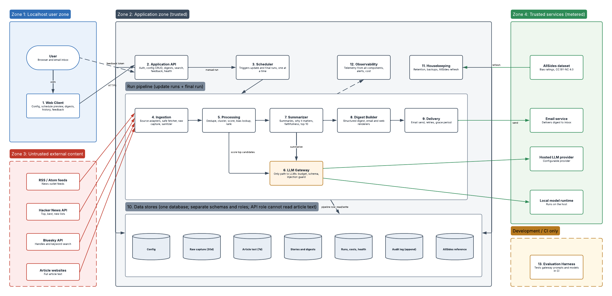
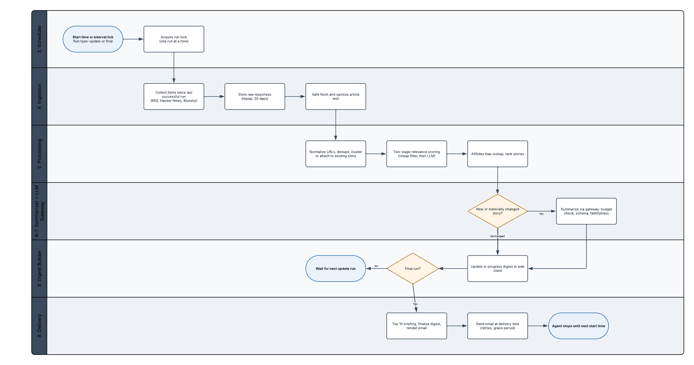

# ADR-0004: Logical architecture

- **Status:** Accepted
- **Date:** 2026-10-27
- **Phase:** Logical Design
- **Requirements addressed:** FR-001 to FR-044, NFR-001 to NFR-025, SEC-001 to SEC-023 (traceability in the Notion Architecture Elements field)
- **Supersedes:** none

## Context

The approved requirements baseline ([ADR-0003](0003-v1-scope-and-requirements-baseline.md))
needs a technology-neutral architecture before the tech stack is chosen. The stack
must follow the architecture ([ADR-0002](0002-phased-design-process-with-exit-checks.md)).
Key forces: untrusted external content reaches both a URL fetcher and an LLM, a hard
monthly budget, user-configured update runs and a final run, and single-user
localhost installs.

## Decision

The system is organized into 13 logical components across four trust zones, as shown in
[News Agent - Logical Architecture (v1)](https://lucid.app/lucidchart/134cea9f-ed2e-4022-948f-e92b1fc37256/edit)
(page 1: Logical Components, page 2: Run Flow).

### Components

| ID | Component | Responsibility |
|---|---|---|
| C1 | Web Client | Configuration, schedule preview, digests, history, search, run history, feedback |
| C2 | Application API | Auth, configuration CRUD, digest queries, search, token-protected feedback, manual runs, health check |
| C3 | Scheduler | Computes update runs and the final run from user settings; one run at a time; retries, resume, rebuild |
| C4 | Ingestion | Source adapters behind one interface, safe fetcher, raw capture, article text extraction and sanitizing |
| C5 | Processing | URL normalization, dedupe, clustering, relevance scoring, AllSides bias lookup, ranking, story updates |
| C6 | LLM Gateway | The only path to any model: provider adapters, budget check, prompt isolation, schema validation, cost metering |
| C7 | Summarizer | Detailed summaries, why it matters, perspective comparison, faithfulness check, link allowlist, top 10 briefing |
| C8 | Digest Builder | Structured digest; email, plain-text, and web renderers; feedback token signing |
| C9 | Delivery | Email send with retries and grace period; delivery records |
| C10 | Data Stores | Config, raw capture (30d), article text (7d), stories and digests, runs/costs/health, audit log, AllSides reference |
| C11 | Housekeeping | Retention cleanup, backups, AllSides dataset refresh |
| C12 | Observability | Logs, traces, metrics, alerts, cost tracking |
| C13 | Evaluation Harness | Development and CI only: relevance, clustering, faithfulness, prompt-injection test sets |

### Trust zones

1. **Localhost user zone:** user, browser, Web Client.
2. **Application zone (trusted):** API, Scheduler, pipeline, Observability, Housekeeping, Data Stores.
3. **Untrusted external content:** RSS/Atom feeds, Hacker News, Bluesky, article websites. Reached only through C4's safe fetcher.
4. **Trusted services (metered):** hosted LLM provider, local model runtime, email service, AllSides dataset.

### Design decisions

| # | Decision | Requirements |
|---|---|---|
| D1 | One logical data store with separate schemas and roles; the pipeline never calls the API. **Provisional** until the database selection analysis in the Final Tech Stack phase. | SEC-017, NFR-017 |
| D2 | Every model call, hosted or local, goes through the LLM Gateway. No component calls a model provider directly. Same pattern as an API gateway: one enforcement point for budget, injection defenses, validation, metering, and provider swaps. | FR-028, FR-032, NFR-007 to NFR-009, NFR-015, SEC-009, SEC-010 |
| D3 | Two-stage relevance scoring: cheap keyword and embedding filters first, LLM scoring only for top candidates. | FR-019, NFR-008 |
| D4 | Summaries are generated during each update run, only for new or materially changed stories. | FR-043, NFR-005, NFR-008 |
| D5 | The digest is a structured artifact; email and web are renderers of it. | FR-033, FR-035, FR-037 |
| D6 | Full article text is visible only to the pipeline; the API never returns it. | FR-013, FR-031, SEC-014 |
| D7 | The Scheduler derives runs from user settings at runtime rather than fixed schedules in code. | FR-004, FR-042 |
| D8 | The local model runtime sits in Zone 4 and is treated as an external service, because it may run on a separate machine. | FR-032, SEC-009 |

### Traceability result

Passed on 2026-10-27. All 92 requirements map to at least one component in the
Notion Architecture Elements field, and every component is covered. Ten requirements
map only to Platform (NFR-014, NFR-016, NFR-018, NFR-019, NFR-020, SEC-006, SEC-015,
SEC-016, SEC-022, SEC-023) and receive concrete elements in the Platform phase.

## Alternatives considered

| Option | Pros | Cons | Why not chosen |
|---|---|---|---|
| Components call LLM providers directly | Fewer moving parts | Budget, injection defenses, and validation duplicated in every caller; provider lock-in | Violates single enforcement point (D2) |
| Single nightly summarization at the final run | Simpler | Final run too slow for the 25-minute target; no in-progress view | D4 meets NFR-005 and FR-043 |
| Separate renderers with their own content logic | Independent formatting | Email and web drift apart | D5 keeps one source of truth |
| Separate databases per component now | Strong isolation | Premature before database analysis | Deferred to database selection |

## Consequences

- **Positive:** Each security control has one clear home. The stack selection has a
  concrete list of capabilities to satisfy.
- **Negative:** The LLM Gateway is a critical path; its failure modes must be handled
  (FR-028 fallback, NFR-007 no-LLM mode).
- **Follow-ups:**
  - Final Tech Stack: database selection analysis with its own ADR; revisit D1 based on the result.
  - Implementation Design: schema design and ERD for C10.
  - Platform: concrete elements for the ten Platform-only requirements.

## Diagram snapshots

Exported from Lucid on 2026-10-27. Lucid remains the editable source.

