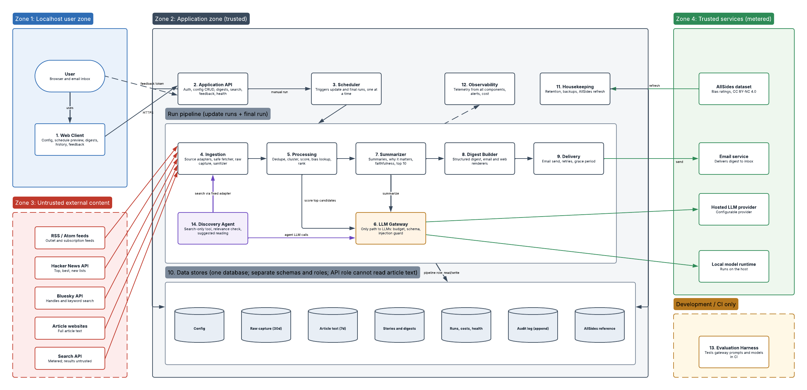
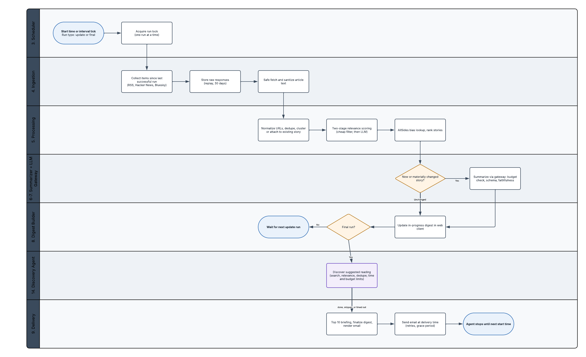

# ADR-0008: Discovery agent and subscription sources

- **Status:** Accepted
- **Date:** 2026-10-27
- **Phase:** Logical Design (feedback loop to Definition)
- **Requirements addressed:** FR-045, FR-046, SEC-024, NFR-026
- **Supersedes:** none (extends [ADR-0004](0004-logical-architecture.md))

## Context

While choosing the LLM Gateway and agent framework, the design was confirmed to be a
fixed pipeline: Ingestion (C4) collects from configured sources, and the LLM only
scores, summarizes, and compares, with no tools (SEC-009). That pipeline only finds
stories from sources the user has configured.

Two additions were proposed:

1. **Subscription sources.** Users who already pay for publications should be able to
   follow them.
2. **Discovery.** A separate agent should look for relevant stories from other outlets
   and offer them as "Suggested reading from other sources," with a short synopsis and
   link.

Per [ADR-0002](0002-phased-design-process-with-exit-checks.md), this is a scope change, so
it went back to Definition first. Four requirements were drafted, reviewed, and approved
on 2026-10-27 in the [Notion Requirements database](https://app.notion.com/p/e1aaccdff30d40e884616cc12e257ebf):

| ID | Requirement | Priority |
|---|---|---|
| FR-045 | Subscription sources | Must |
| FR-046 | Suggested reading from other sources | Should |
| SEC-024 | Discovery agent restrictions | Must |
| NFR-026 | Discovery spending limit | Must |

The baseline is now 96 requirements: 46 functional, 26 non-functional, and 24 security
(77 Must, 17 Should, 1 Could, 1 Won't). No previously approved requirement was changed.

Facts checked during the analysis:

- Logging in to publishers on the user's behalf would mean storing passwords or session
  cookies and usually breaks publisher terms (NFR-022). Publisher feeds are the supported
  path. For example, Substack lists paid posts in its RSS feed but
  [truncates them at the paywall](https://www.newsletterapi.io/blog/substack-rss-feed);
  private subscriber feeds exist only for [podcasts](https://substack.com/features).
- Agent frameworks can cap a run's model requests, tool calls, and cost. Pydantic AI's
  `UsageLimits`, for example, checks cost
  [only after a response arrives](https://pydantic.dev/docs/ai/production/), so the
  gateway's pre-call budget check remains the actual cap.

## Decision

### New component

| ID | Component | Responsibility |
|---|---|---|
| C14 | Discovery Agent | Once per run window, searches for stories from outlets outside the configured sources. Scores relevance from title and snippet, drops duplicates, and produces the "Suggested reading from other sources" section within its time, call, and budget limits |

Subscription sources do not need a new component. They are a flag on the C4 RSS/Atom
adapter.

### Design decisions

These continue the numbering from ADR-0004.

| # | Decision | Requirements |
|---|---|---|
| D9 | **Discovery is the only agentic component in v1.** C14 is the only place where an LLM chooses actions, and its only tool is a read-only search. The core pipeline is unchanged: a fixed sequence of steps where the LLM has no tools (SEC-009). | FR-046, SEC-024, SEC-009 |
| D10 | **All outbound calls to Zone 3 go through C4, including search.** The search adapter is a C4 source adapter with a fixed host. Its responses are raw-captured for replay and evaluation, and it uses the same retries and rate limits (NFR-003, NFR-022). C14 calls the adapter; it never makes requests itself. The search API sits in Zone 3: it is metered, but its results are untrusted content. | SEC-024, SEC-011, FR-014 |
| D11 | **Discovery runs in the final run, after core processing and before the digest is finalized.** Its time limit (default 10 minutes) fits within the 25-minute final-run target (NFR-005). If it finishes, is skipped, fails, or times out, digest assembly continues; any failure is recorded. Suggestions are an optional section of the structured digest (D5) and are not part of story tracking. | FR-046, NFR-005, FR-033 |
| D12 | **Discovery spends from its own sub-budget within the nightly cap.** The gateway (D2) checks this budget before every discovery LLM call. Search calls are metered in the same spend ledger and count toward the monthly cap. Discovery runs after core spend is known, so it can never reduce what the core digest gets. | NFR-026, NFR-007, FR-007 |
| D13 | **Subscription sources are collected from feeds only.** Only the feed's title, link, date, author, and preview are collected; C4 skips the article page fetch (FR-013). Private subscriber feed URLs that contain tokens are stored and masked as secrets. The system has no place to store publisher logins. | FR-045, NFR-022, SEC-014 |

### Traceability

The four new requirements map to components in the Notion Architecture Elements field:

| Requirement | Components |
|---|---|
| FR-045 | C1, C2, C4, C5, C7, C10 |
| FR-046 | C14, C3, C4, C6, C8 |
| SEC-024 | C14, C4, C6, C13 |
| NFR-026 | C6, C14, C10, C12 |

Every component, including C14, is covered by at least one requirement.

## Alternatives considered

| Option | Pros | Cons | Why not chosen |
|---|---|---|---|
| Make the whole pipeline agentic (LLM decides where to look) | Broadest discovery | Prompt injection can drive tool use; unpredictable cost; not reproducible; harder to test | D9 keeps the trusted core fixed and limits agency to one bounded component |
| Discovery agent reads result pages for better synopses | Richer synopses and better relevance | More exposure to injection and SSRF; more cost and time | Deferred. v1 uses snippets only, by user decision |
| Log in to subscription sites with the user's credentials or cookies | Full text of paid articles | Stores high-value credentials; usually breaks publisher terms | Rejected (NFR-022, SEC-014) |
| Run discovery during every update run | Fresher suggestions | Cost grows with the number of runs | Once per run window keeps NFR-008 predictable |
| C14 calls the search API directly | One less hop | Second path to Zone 3, outside the safe fetcher, raw capture, and rate limits | Breaks D10 |
| Place the search API in Zone 4 | It is a metered, keyed service | Its results are third-party content | Results are untrusted, so it belongs in Zone 3 |

## Consequences

- **Positive:** Wider coverage without changing the trusted core digest. Discovery's
  cost, time, and failures are contained, and the digest never depends on it. Users can
  follow paid publications without the system holding their logins.
- **Negative:**
  - A new paid dependency (the search API).
  - The gateway must support tool-calling requests, limited to approved tools.
  - Discovery uses part of the final run's time budget.
  - The prompt-injection test set must cover poisoned search results.
- **Follow-ups:**
  - Next ADR: LLM Gateway and agent framework, now covering C14's agent loop.
  - Stack selection: choose the search API and record it in the spend ledger's price table.
  - Security Review: threat model for C14 and the search adapter.
  - Implementation Design: schema for suggestions, discovery runs, and subscription flags;
    a C14 sequence diagram.

## Diagram snapshots

These are exported from
[News Agent - Logical Architecture (v2)](https://lucid.app/lucidchart/419ac04d-5569-4d4e-a2cd-63ef172422ea/edit),
which is now the editable source. The v1 snapshots in ADR-0004 are kept as history.

